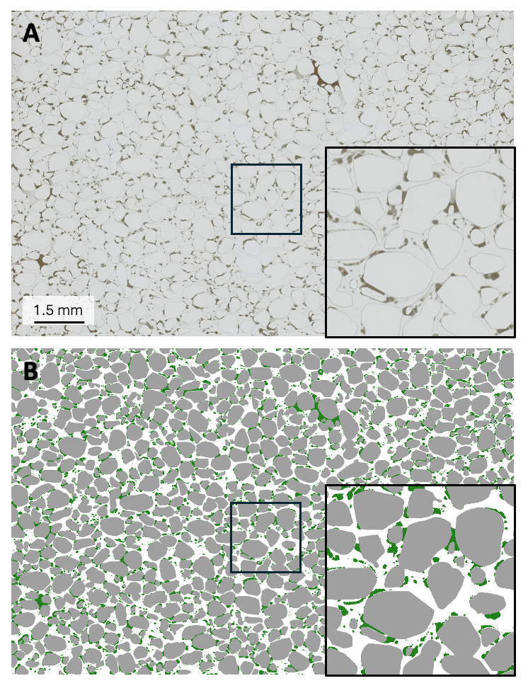

# Biofilm images

The supplied image files are available in the [complete dataset](https://github.com/hkhoshtarash/biofilm-flow-mixing-paper#complete-dataset). See `FILE_INDEX.csv` for the file list.



*Imaging and segmentation overview provided with the paper materials.*

From the repository root, restore this folder with:

```bash
python3 download_data.py --group 01_images
```
