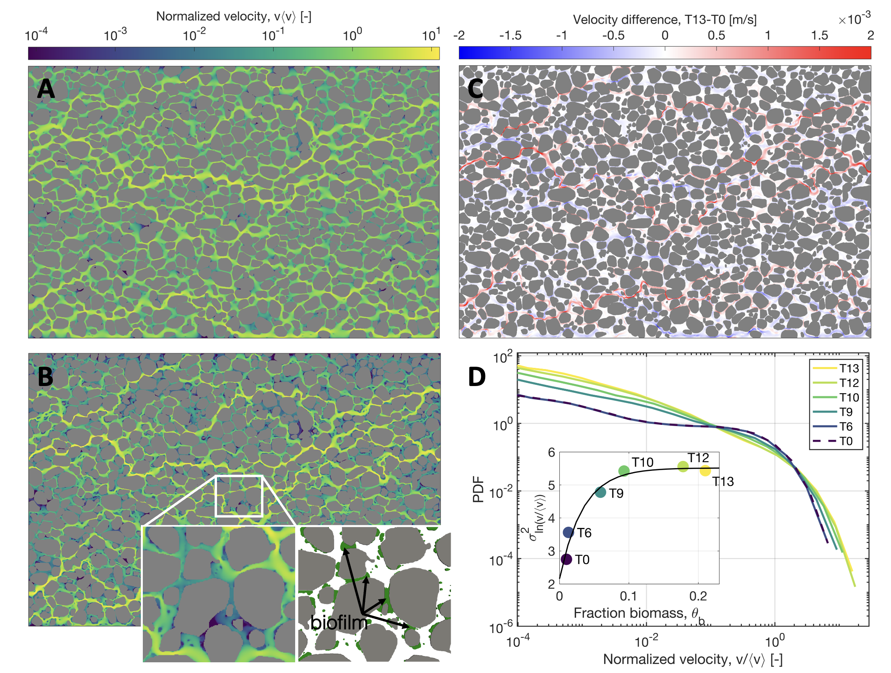

# Concentration and velocity fields

## Download all concentration MAT files, one ZIP per stage

Every stage ZIP contains **all `.mat` files** from that stage's supplied concentration folder, including **all 59 `C_cut_T*.mat` snapshots**. There are **354 concentration snapshots in total**. Other supplied MAT files in each folder are retained too.

- **[T0.zip](https://github.com/hkhoshtarash/biofilm-flow-mixing-paper/releases/download/data-v2/T0.zip)** — 59 concentration snapshots; 62 MAT files total.
- **[T6.zip](https://github.com/hkhoshtarash/biofilm-flow-mixing-paper/releases/download/data-v2/T6.zip)** — 59 concentration snapshots; 60 MAT files total.
- **[T9.zip](https://github.com/hkhoshtarash/biofilm-flow-mixing-paper/releases/download/data-v2/T9.zip)** — 59 concentration snapshots; 60 MAT files total.
- **[T10.zip](https://github.com/hkhoshtarash/biofilm-flow-mixing-paper/releases/download/data-v2/T10.zip)** — 59 concentration snapshots; 61 MAT files total.
- **[T12.zip](https://github.com/hkhoshtarash/biofilm-flow-mixing-paper/releases/download/data-v2/T12.zip)** — 59 concentration snapshots; 61 MAT files total.
- **[T13.zip](https://github.com/hkhoshtarash/biofilm-flow-mixing-paper/releases/download/data-v2/T13.zip)** — 59 concentration snapshots; 61 MAT files total.

Unzip a stage file to obtain its stage-named directory (`T0`, `T6`, etc.). To use the L* batch calculation, place these stage directories under `3- Velocity_Conc_fields/ConcentrationField/` and also restore the supplied `L_star` saved tables. The complete-data downloader handles that automatically.

## Other supplied fields

The original velocity MAT grids, saved L* tables, and all other supplied files remain in the complete dataset. Run `python3 download_data.py` from the repository root to restore all four folders. Its field-group archive remains on the original data-v1 release; it contains every concentration field as well. The new stage ZIPs are direct, easier-to-find downloads rather than replacement scientific data.

## Velocity overview

*Overview of the velocity fields and distributions supplied with the paper materials.*
