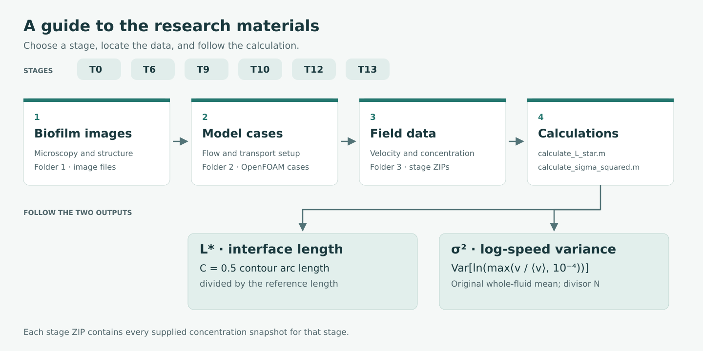
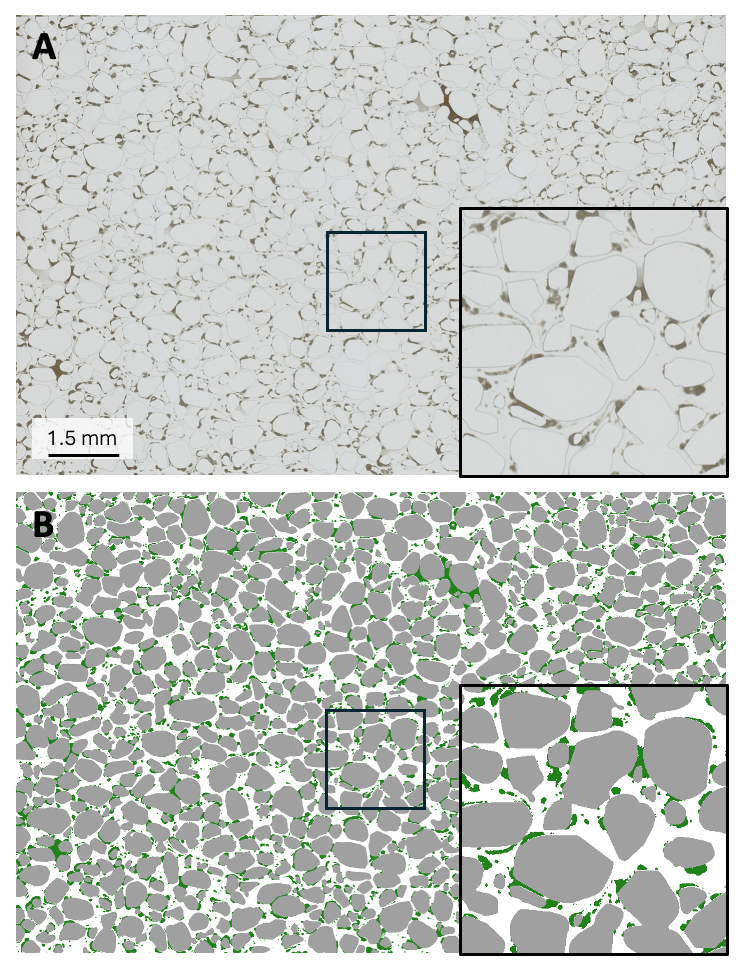
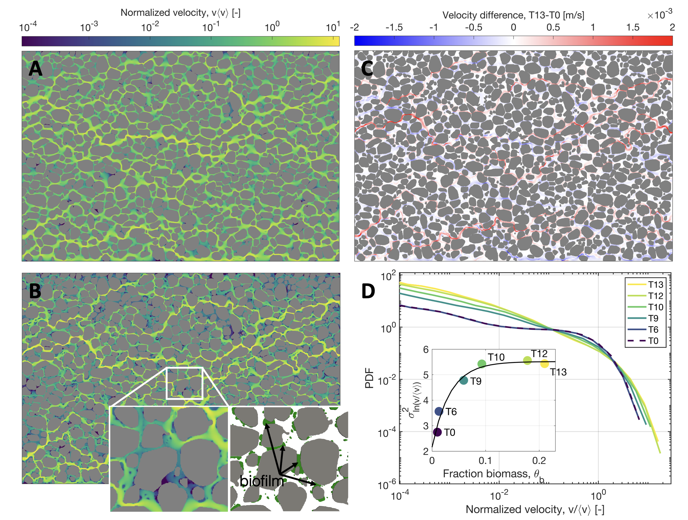

# Biofilm-induced flow and mixing

Data, model cases, and calculation files accompanying the paper on biofilm-induced flow heterogeneity, interface deformation, and mixing in porous media.

[Reviewer guide](#reviewer-guide) · [Concentration downloads](#concentration-fields) · [Figures](#research-overview) · [Calculations](#calculations) · [Complete dataset](#complete-dataset)

## Reviewer guide



- **Inspect the experimental structure:** [biofilm images](1-%20Biofilm%20section%20images/).
- **Inspect the model inputs:** [flow and transport cases](2-%20openFOAM_setup_cases/).
- **Choose a stage and field:** [velocity and concentration data](3-%20Velocity_Conc_fields/).
- **Recover the metrics:** [L* calculation](4-%20Scripts/calculate_L_star.m) and [σ² calculation](4-%20Scripts/calculate_sigma_squared.m).

## Concentration fields


**All 354 concentration snapshots are included.** Download the MAT files separately for each stage:

- **[T0.zip](https://github.com/hkhoshtarash/biofilm-flow-mixing-paper/releases/download/data-v2/T0.zip)**
- **[T6.zip](https://github.com/hkhoshtarash/biofilm-flow-mixing-paper/releases/download/data-v2/T6.zip)**
- **[T9.zip](https://github.com/hkhoshtarash/biofilm-flow-mixing-paper/releases/download/data-v2/T9.zip)**
- **[T10.zip](https://github.com/hkhoshtarash/biofilm-flow-mixing-paper/releases/download/data-v2/T10.zip)**
- **[T12.zip](https://github.com/hkhoshtarash/biofilm-flow-mixing-paper/releases/download/data-v2/T12.zip)**
- **[T13.zip](https://github.com/hkhoshtarash/biofilm-flow-mixing-paper/releases/download/data-v2/T13.zip)**

Each ZIP contains all 59 `C_cut_T*.mat` snapshots for that stage, plus all other MAT files supplied in its concentration folder. The stage names are experimental/model stages; the individual simulation times are in the `C_cut_T<time>.mat` filenames. See [the field folder](3-%20Velocity_Conc_fields/README.md) for details.

## Research overview

### Imaging and segmented structure

<p align="center">
  
</p>

*Microscopy and segmentation overview, with magnified regions showing the porous structure.*

### Velocity fields and distributions



*Normalized velocity fields, the T13–T0 velocity difference, and stage-dependent velocity distributions.*

## Calculations

The [Scripts folder](4-%20Scripts/) contains only two self-contained files. Each includes its method, assumptions, and usage instructions in the comments.

- **[calculate_L_star.m](4-%20Scripts/calculate_L_star.m)** — recover the total C=0.5 contour length and divide by the reference interface length. Separate contour components and NaN masks are preserved.
- **[calculate_sigma_squared.m](4-%20Scripts/calculate_sigma_squared.m)** — normalize speed by the original whole-fluid mean, floor normalized speed at `1e-4`, and calculate the population variance of its natural logarithm. Regional calculations share the same whole-fluid reference mean.

After restoring the data, open MATLAB in the repository root:

```matlab
addpath('4- Scripts');
calculate_L_star(pwd, fullfile(tempdir,'L_star.csv'));
calculate_sigma_squared(pwd, fullfile(tempdir,'sigma_squared.csv'), 'positive-speed');
```

The example explicitly treats zero-speed matrix entries as solid-coded points. Select the fluid-mask policy appropriate to your sample, as described in the σ² function comments. Valid zero-speed fluid points must remain included through a suitable mask.

## Complete dataset

Large images, meshes, and field arrays are distributed as release assets. **GitHub's normal “Download ZIP” button does not include those large data files.**

For concentration fields alone, use the stage ZIP links above. To restore the complete four-folder dataset:

```bash
git clone https://github.com/hkhoshtarash/biofilm-flow-mixing-paper.git
cd biofilm-flow-mixing-paper
python3 download_data.py
```

The downloader requires Python 3.11+ and checks file integrity. It restores the images, flow and transport cases, field data, and current two-file Scripts folder. Existing conflicting files are preserved; use `--output /path/to/new-folder` to restore into a separate directory.

[Current release](https://github.com/hkhoshtarash/biofilm-flow-mixing-paper/releases/tag/data-v2) · [Future upload instructions](UPLOAD_GUIDE.md)
